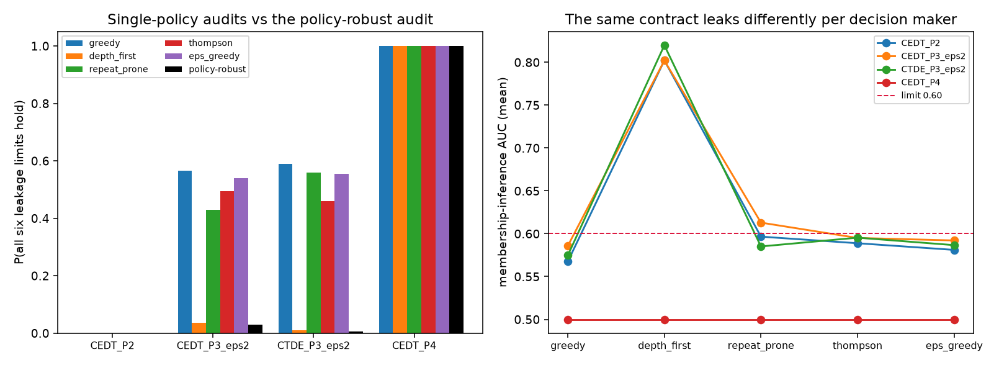

# Finding 5: decision-maker-dependent leakage — definition and analysis

Premise (2026-09-08): leakage is decision-maker-dependent; this study
defines and analyzes that dependence.

## Definition

For a fixed information contract m (topology × disclosure level), the
transcript an attacker observes is generated jointly by the mechanism
and the decision policy π driving the queries. Leakage is therefore a
functional of both:

    L_c(m, π)   for each preregistered channel c.

- A **single-policy audit** certifies L_c(m, π_audit) ≤ limit_c for one
  audit policy (what every grading before 2026-09-08 did, using the
  scripted greedy policy).
- A **policy-robust audit** certifies L̂_c(m, Π) = max over π in a
  declared policy class Π of L_c(m, π) ≤ limit_c.

The 2026-09-02 LLM run gave the first evidence that the gap is real
(CEDT-P3 membership AUC 0.85 under an LLM vs 0.60 scripted). This study
(`dm_leakage.py`, 200 base worlds, identical worlds/noise per archetype)
quantifies it with five R-seat archetypes spanning behaviors observed in
the scripted/LLM/tool sessions: `greedy` (the audit policy),
`depth_first` (LLM ladder-climbing), `repeat_prone` (anchoring /
repeated queries), `thompson` (tool-delegation style sampling),
`eps_greedy` (erratic operator).

## Results

P(all six leakage limits hold), per audit type:

| contract | greedy | depth_first | repeat_prone | thompson | eps_greedy | **policy-robust** |
| --- | ---: | ---: | ---: | ---: | ---: | ---: |
| CEDT-P2 | 0.00 | 0.00 | 0.00 | 0.00 | 0.00 | 0.00 |
| CEDT-P3 (ε=2) | 0.56 | 0.04 | 0.43 | 0.49 | 0.54 | **0.03** |
| CTDE-P3 (ε=2) | 0.59 | 0.01 | 0.56 | 0.46 | 0.56 | **0.01** |
| CEDT-P4 | 1.00 | 1.00 | 1.00 | 1.00 | 1.00 | **1.00** |

1. **A P3 certificate issued under the scripted audit policy is close to
   worthless for a different decision maker.** The pass probability
   drops from ~0.56–0.59 to 0.01–0.03 under the policy-robust audit.
   The killer archetype is `depth_first` — exactly the behavior real
   LLM agents exhibited — which concentrates membership mass on few
   candidates (mean MI AUC 0.80–0.82 vs limit 0.60). `repeat_prone`
   also crosses the limit at P3 (0.61).
2. **P4 is policy-invariant by construction** (γ = 0: the disclosed
   fields carry no candidate-specific information, so no query pattern
   can concentrate it). The only contract whose leakage certificate
   survives a change of decision maker is the one that discloses
   nothing per-candidate.
3. **Contract implication (preregistration language):** leakage limits
   must be certified against a declared policy class (or worst case),
   not a single audit transcript; alternatively the contract must
   *mechanically* destroy query concentration (per-epoch opaque-ID
   rotation / transcript expiry — the 13.2-4 fix — which converts
   `depth_first` transcripts back into near-chance evidence).
4. Utility note: the archetypes reproduce the LLM-run trade exactly —
   under CEDT-P3, `depth_first` has a slightly *higher* found-rate
   (0.86 vs 0.81 greedy) and shorter time-to-first-qualifier, but ~30%
   lower labels/nh (0.022 vs 0.031). Its extra leakage is not paid for
   by across-the-board utility gains; the audit gap is a genuine blind
   spot, not a price.

Simulated units; base card; attacker models are the preregistered
Bayes-style upper-bound constructions.
