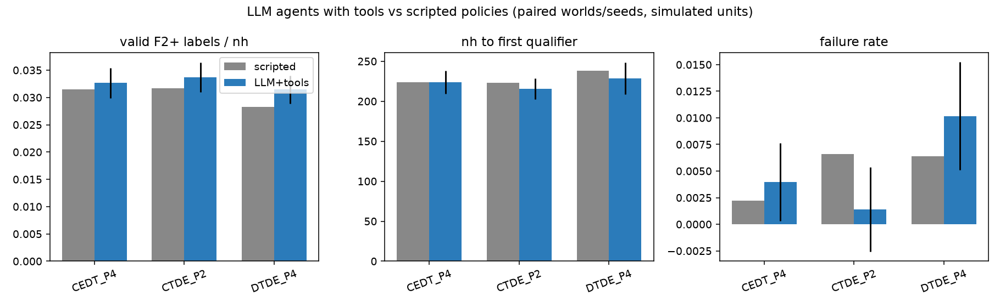

# LLM agents with tools as decision makers — results

Date: 2026-09-02 · Mode: `prior_predictive_simulation`:
**all node-hours are simulated units**; nothing here is a CHPC measurement
or a materials-discovery claim.

Design: the R and H parties are played by LLM agents that make
the round-by-round decisions, with access to optimization/sampling tools
(not pure-LLM, not scripted). Model: `Qwen/Qwen3-4B-Instruct-2507` on the
DGX's resident vLLM server, temperature 0.2.

## Setup

Paired design through the identical stepwise env (`env.py`, replaying the
same prior worlds and noise fields as `../prior_predictive/simulator.py`):

- Conditions: DTDE-P4 (outside option), CEDT-P4 (best minimal contract from
  the prior-predictive study), CTDE-P2.
- 9 worlds (3 per prior card: base / strong_coupling / adversarial) × 2
  paired seeds × {scripted, LLM} = 108 campaigns; budget 250 simulated nh,
  40 rounds max (reduced from 500/80 to keep the LLM arm tractable).
- The scripted arm runs the exact greedy policies of the vectorized
  simulator through the same env; the LLM arm makes every decision via the
  agent loop (`agents.py`) with the toolbox (`tools.py`).

Two production runs:

- **v1** (`llm_grid_raw.json.gz`): the initial toolbox.
- **v2** (`llm_grid_raw_v2.json.gz`): identical except one fix to
  `config_montecarlo` — v1 sampled failures from the smooth `pfail` model
  only and did not treat a predicted memory overrun (> 64 GB/node) as a
  hard failure; v2 does, and flags `mem_violation` in its output.

## Headline results (paired deltas, LLM − scripted; n = 18 pairs/condition)

v2 (fixed toolbox):

| Condition | labels/nh | nh to first qualifier | fail rate | memfail rate | validity |
| --- | ---: | ---: | ---: | ---: | ---: |
| DTDE-P4 | +0.003 (se .003) | −9.6 (se 19.9) | +0.004 | +0.004 | +0.006 |
| CEDT-P4 | +0.001 (se .003) | +0.4 (se 14.5) | +0.002 | +0.002 | +0.000 |
| CTDE-P2 | +0.002 (se .003) | −7.0 (se 13.0) | **−0.005** | −0.003 | +0.003 |

The LLM agents are **statistically indistinguishable from (or slightly ahead
of) the hand-scripted greedy policies** on throughput and discovery at
matched information, with zero parse fallbacks to the scripted policy in
1,656 LLM calls (v2). Qualifier counts are noisy at n=18 (CEDT-P4:
−0.28 ± 0.21); nothing here overturns the prior-predictive study's
contract-level conclusions, which used 1,000 worlds.

## The v1 → v2 lesson: tool blind spots propagate through delegation

v1's LLM arm showed a consistent excess of failures that were almost
entirely **memory** failures (memfail deltas: +0.025 DTDE-P4, +0.038
CEDT-P4, +0.043 CTDE-P2; validity −0.05 to −0.11). Trace: the H agents
mostly delegated config choice to `config_montecarlo`, whose v1 failure
model omitted the hard 64 GB bound, so its mean-cost ranking sometimes
surfaced configs the scripted policy's hard penalty always avoided. The
agents inherited the tool's blind spot. Fixing the tool (v2) removed the
excess (memfail deltas +0.004 / +0.002 / −0.003) and restored validity
parity — the agents' judgment was not the problem; the tool's model was.

For the MRD/contract framing this is a genuine finding: **when parties
delegate to algorithms, the tool layer becomes part of the trusted surface
of the contract** — a mis-specified shared tool can silently shift the
realized outcome vector in ways neither party's disclosed information
explains. Tool audits belong in the preregistration checklist alongside
attacker models.

## How the agents actually behaved (v2 telemetry, 54 campaigns)

- 1,656 LLM calls (R 944, H 712); 769 interactive tool calls
  (`rank_candidates` 470, `config_montecarlo` 299); **0 fallbacks**.
- R grounded 470 of 474 consulted decisions in a tool call it made first,
  and overrode the tool's top suggestion in 33% of them. It delegated
  965 rounds (~67% of all R decisions) — three-to-one to Thompson sampling
  over UCB (264 vs 101 delegations), the parameters being its own choice.
- H consulted the Monte-Carlo tool before 299 of 413 decisions and took its
  argmin almost never (299 overrides) — it used the sampled cost/risk table
  as information and picked its own row, typically trading a little expected
  cost for lower failure probability. Its delegations (1,026 rounds) split
  between `config_montecarlo(quantile=0.95)` and
  `config_optimizer(mem_margin 1.1–1.5, risk_weight 0.5)`.
- Nothing was scripted in the LLM arm: every decision was either an LLM
  choice (usually tool-informed) or the output of an algorithm the LLM
  explicitly configured and time-boxed (≤ 5 rounds per delegation).

## Caveats

- n = 18 pairs per condition — this is a demonstrator of the pathway, not
  a re-run of the 1,000-world grid; the standard errors above say which
  deltas mean anything (mostly: parity).
- One model (Qwen3-4B) at one temperature; a sweep over several LLMs is
  the natural extension (`run_llm_grid.py` takes `--model`/`--base-url`).
- Reduced budget (250 snh) compresses discovery rates for both arms
  equally, but interacts with the F4 gate; qualifier counts are the
  noisiest metric.
- Leakage: the LLM arm changes *decision-making*, not the disclosure
  channels — the R-side attacker accumulators are computed identically and
  showed no systematic difference; H-side analytic attacks were not
  re-scored here.
- The delegation mechanism caps at 5 rounds by design; without the prompt
  nudge added after the first smoke test, the 4B model skipped interactive
  tool calls entirely and only delegated — worth remembering when reading
  the telemetry as "agent preference".
