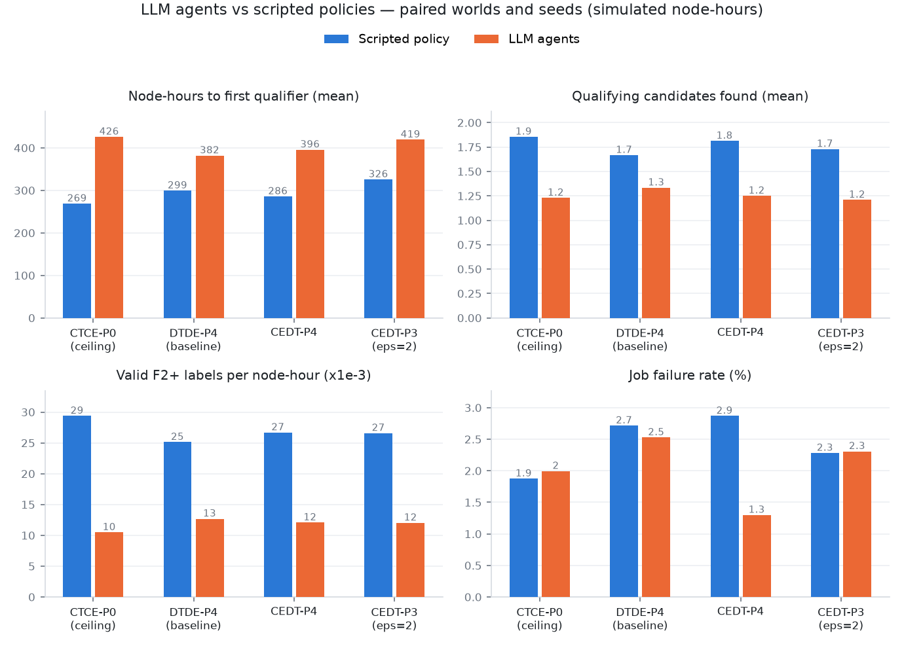
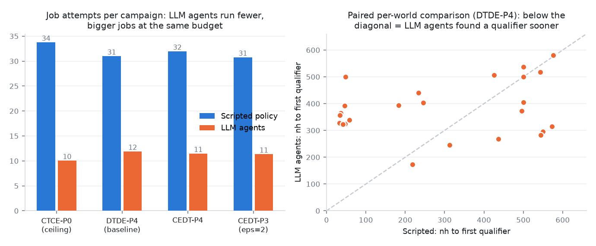

# LLM agents as decision makers — results

Design (2026-09-02): the multi-party experiment uses the same or different
LLM agents as decision makers rather than simple machine-learning models.
This stage replaces the scripted
policies of the prior-predictive simulator with actual LLM agents and measures
what changes. All node-hours are SIMULATED UNITS; nothing here is a CHPC
measurement or a materials-discovery claim.

## Design

- `llm_experiment.py` re-implements the campaign engine of
  `../prior_predictive/simulator.py` as a scalar loop with two pluggable
  decision seats per round:
  - **R seat** (research party): which candidate to advance (or stop);
  - **H seat** (HPC party; joint seat under CTCE): which execution config.
- Each seat is played either by the **scripted policy** (bit-exact port of the
  deterministic acquisition/config rules) or by an **LLM agent**. The harness,
  not the model, enforces the information contract: prompts contain exactly
  the observations the contract level permits — the same quantities the
  scripted policy consumes (posterior gap stats, contract-degraded cost
  views, disclosed size-class bounds, local config predictions). Illegal or
  unparseable model outputs fall back to the scripted choice and are counted.
- **Two parties, two different models**, served by vLLM 0.28 on the DGX
  (GB10, both servers resident simultaneously, then shut down):
  - R: `Qwen/Qwen3-4B-Instruct-2507` (port 8010);
  - H: `nvidia/NVIDIA-Nemotron-3.5-Lightning-30B-A3B-NVFP4` (port 8011,
    `enable_thinking: false`, the office's proven fast checkpoint).
  Temperature 0 for reproducibility; JSON-only replies with a short "why".
- Paired evaluation: 24 worlds (8 per prior card) × 2 seeds × 4 conditions
  (CTCE-P0 ceiling, DTDE-P4 baseline, CEDT-P4, CEDT-P3 ε=2) × 2 policies on
  identical worlds, seeds, and noise fields. 2,147 LLM calls per seat,
  **0 fallbacks** on either seat, 888 s wall. Win-win grading reuses
  `eval_world` with each policy family graded against its own DTDE baseline.

## Headline findings

| condition | policy | nh to 1st qual | found rate | mean quals | labels/nh | fail rate | validity | R-gain | H-gain | leak ok | win-win |
|---|---|---:|---:|---:|---:|---:|---:|---:|---:|---:|---:|
| CTCE_P0 | scripted | 269 | 0.92 | 1.85 | 0.0294 | 0.019 | 0.975 | 0.25 | 0.46 | 0.00 | 0.00 |
| CTCE_P0 | llm | 426 | 0.90 | 1.23 | 0.0105 | 0.020 | 0.975 | 0.08 | 0.08 | 0.00 | 0.00 |
| DTDE_P4 | scripted | 299 | 0.83 | 1.67 | 0.0251 | 0.027 | 0.966 | 0.00 | 0.00 | 1.00 | 0.00 |
| DTDE_P4 | llm | 382 | 0.88 | 1.33 | 0.0127 | 0.025 | 0.969 | 0.00 | 0.00 | 1.00 | 0.00 |
| CEDT_P4 | scripted | 286 | 0.85 | 1.81 | 0.0267 | 0.029 | 0.958 | 0.08 | 0.17 | 1.00 | 0.04 |
| CEDT_P4 | llm | 396 | 0.88 | 1.25 | 0.0121 | 0.013 | 0.983 | 0.04 | 0.00 | 1.00 | 0.00 |
| CEDT_P3_eps2 | scripted | 326 | 0.90 | 1.73 | 0.0266 | 0.023 | 0.973 | 0.25 | 0.17 | 0.33 | 0.00 |
| CEDT_P3_eps2 | llm | 419 | 0.85 | 1.21 | 0.0120 | 0.023 | 0.976 | 0.08 | 0.04 | 0.00 | 0.00 |

1. **The MRD infeasibility survives the switch to LLM decision makers.** No
   condition approaches the preregistered 0.90 win-win probability under
   either policy family. The finding of the prior-predictive stage is not an
   artifact of the scripted policies.
2. **LLM agents trade breadth for depth.** They run about a third as many
   jobs per campaign (10–12 vs 31–34), pushing single candidates up the
   fidelity ladder instead of screening broadly (R-seat agreement with the
   scripted choice: 36%). Consequence: half the total qualifiers and half
   the labels per node-hour, but a slightly *higher* chance of finding at
   least one qualifier in hard worlds (found rate 0.88 vs 0.83–0.85 in the
   decentralized arms) — the depth-first ladder always completes, while the
   breadth-first screen sometimes spends the budget without confirming
   anything at F4.
3. **The H-model is risk-averse: it buys reliability with node-hours.**
   H-seat agreement with the scripted argmin is only 12%; it systematically
   picks configs with lower predicted failure instead of lowest expected
   cost. Under CEDT-P4 this halves the failure rate (1.3% vs 2.9%) and
   raises validity (0.983 vs 0.958) at the price of throughput. This
   reproduces, with an actual LLM, the tail-safety-vs-mean-throughput
   trade the education-axis sweep found for taught novices.
4. **Decision style is itself a leakage channel.** Under CEDT-P3 (ε=2) the
   LLM's repeated same-candidate queries concentrate membership mass:
   R membership-inference AUC rises to **0.849 vs 0.603** scripted (limit
   0.60), collapsing leak-ok from 0.33 to 0.00, while the identity and
   H-side channels stay unchanged (id-acc 0.058/0.059, telemetry AUC
   0.510/0.523, rank-corr 0.116/0.110). A contract audited against one
   policy's transcript statistics does not automatically hold for another
   decision maker — the leakage limits must be re-verified per agent, which
   strengthens the earlier per-epoch ID-rotation recommendation (13.2-4).
5. **Full information helps the optimizer more than the language model.**
   The LLM loses the most ground at the CTCE-P0 ceiling (426 vs 269 nh to
   first qualifier): with exact costs available, the scripted argmax
   exploits them; the LLM keeps its heuristic depth-first style.

The paired scatter (right) shows the mechanism: scripted campaigns are
bimodal (very fast when an early screen hits, budget-capped otherwise);
LLM campaigns are consistent mid-range. Sample transcript with the agents'
own one-line rationales: `results/llm_traces.json.gz`.

## Caveats

- Pilot scale (24 worlds × 2 seeds vs 1,000 × 30 for the scripted grid);
  differences quoted are means over 48 paired campaigns per condition.
- One model pair, temperature 0, single-turn prompts with no memory beyond
  the observable state, and no fine-tuning or few-shot exemplars; a
  stronger/planning-tuned model or a scratchpad could close the efficiency
  gap. The finding that leakage profiles are policy-dependent does not
  depend on this.
- The LLM sees the same engineered state the scripted policy uses; it
  cannot invent new observations. This is by design (contract enforcement),
  but it means the LLM is not exercising open-ended tool use.

## Reproduce

DGX: bring up the two vLLM servers (see model list above), then
`python llm_experiment.py --worlds-per-card 8 --out results/llm_results_v2.json`
from a venv with numpy/scipy/httpx. Analysis: `python analyze_llm.py`
(numpy/matplotlib). The DGX workspace used was `~/mpt_llm`; both vLLM
servers were stopped after the run.
