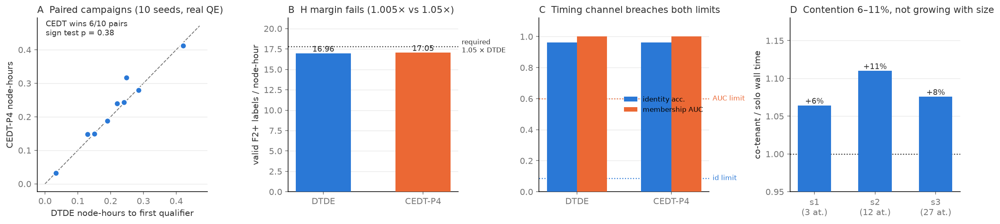

# Live CEDT-P4 vs DTDE comparison — RESULTS (measured, granite grn061)

**SLURM job 1919945, COMPLETED, exit 0.** Started 2026-09-08 20:55 MDT,
ended 2026-09-09 16:44 MDT (19 h 49 m wall). 10 paired seeds × 2 arms ×
24 QE calls = **480 real Quantum ESPRESSO runs**, 29 CC0 MX₂ candidates
as 3×3 supercells, F1→F3 ladder (setup: `JOB_SETUP.md`). Total measured
cost **9.41 node-hours** against the 100 nh cap. Collected 2026-09-09
by `collect_live.sh`; graded by the preregistered `analyze_live.py`
(committed before submission; no post-hoc changes).

## Preregistered grading: NOT MET

`results/live_grading.json`:

| criterion (frozen 2026-09-09) | measured | verdict |
| --- | --- | --- |
| R — PW60: CEDT-P4 beats DTDE on nh-to-first-qualifier in ≥ 60% of paired seeds | 6/10 = 0.60, one-sided sign test p = 0.377 | passes **exactly at the boundary**, statistically indistinguishable from a coin flip |
| H — valid F2+ labels per node-hour ≥ 1.05 × DTDE | **1.005×** (17.05 vs 16.96) | **FAIL** |
| H — failure rate ≤ DTDE + 0.04 | 0.029 vs 0.033 (CEDT slightly better) | pass |
| **preregistered_success** | | **false** |

The paired campaigns are nearly identical (fig. panel A): per-seed
node-hour totals agree within a few percent, and both arms find the
same qualifiers on most seeds. The broker's per-class execution
right-sizing (F1 `-np 16`, F2 `-np 32 -nk 2`, F3 `-np 32 -nk 4` vs
DTDE's worst-case `-np 32 -nk 1`) bought **+0.5% throughput on real
hardware, not the ≥ 5% the calibrated twin predicted**. A plausible
mechanism the twin did not price: grn061 is charged as a whole node, so
using fewer ranks (F1's `-np 16`) saves no node-hours unless jobs are
co-scheduled — under whole-node accounting, most of the simulated
right-sizing gain is an artifact of per-core billing assumptions. This
is recorded as a twin deficiency, not explained away.

**Conclusion (per the preregistered stopping rule): at this task scale
on this machine, the live head-to-head does not confirm the win-win
feasibility claim.** The simulated 0.92 P(win-win) for CEDT-P4 at ×30–
×100 scale is not supported by the measurement; the H margin, already
identified as the binding constraint, is where it fails.

## Executed timing attacks on the real wire log (accept-and-measure)

`wire_attack.py` → `results/wire_attack_results.json`. Attacker sees
only the wire fields (opaque ID, class, ranks/npool, wall time, charge,
ok bit); scoring ground truth from `campaigns.jsonl`.

| attack (leave-one-seed-out) | DTDE | CEDT-P4 | frozen limit |
| --- | ---: | ---: | ---: |
| exact candidate identity from wall-time fingerprints | **0.963** | **0.963** | 0.087 (prior 0.037 + 0.05) |
| membership inference AUC | **1.000** | **1.000** | 0.60 |

On real, quiet, dedicated hardware, per-candidate wall-time
fingerprints are essentially unique: an observer with labeled timing
history on these (public, CC0) structures de-anonymizes 96% of opaque
IDs and reconstructs campaign membership perfectly — identically at
P4, whose field-level redaction removes nothing the timing channel
carries. This extends the pilot finding (config-rank extraction 0.74
through timing) from H's protected surface to R's: **without timing
masking (batched returns, quantized/padded durations), no disclosure
level tested here holds its leakage certificate on real hardware.**
Caveat: the identity attack assumes the attacker has labeled reference
timings for the candidate pool (true here — the structures are public;
optimistic for genuinely private pools), but the membership/linkage
result needs only unlabeled fingerprint clustering across campaigns.

## Files

- `results/campaigns.jsonl` — 20 campaign records incl. per-job truth
- `results/wire_log.jsonl` — the 480-message wire view (attack input)
- `results/live_grading.json` — preregistered grading output
- `results/wire_attack_results.json` — executed attack numbers
- `results/live_1919945.log`, `results/progress.json` — run provenance
