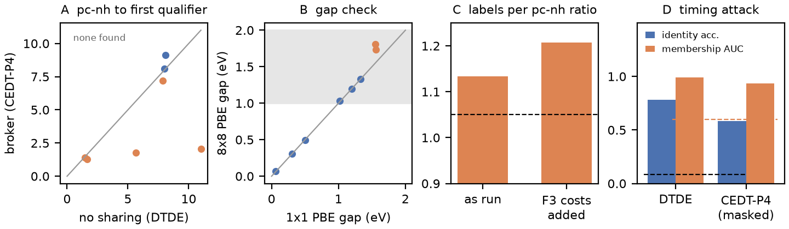

# Comparison No. 2, attempt 2: final grading (2026-09-30)

Sources: window A `1973175`, window B `1973176` (COMPLETED, exit 0,
6 d 23 h) and the F3 repair pass `2048364` (COMPLETED, exit 0, 2 d 3 h)
on granite grn061. Every number below is measured on hardware; nothing
here comes from the simulator.

## Setup in one paragraph

Two parties screen 29 MX2 monolayers at 8x8 supercells (192 to 384
atoms, PBE, Quantum ESPRESSO 7.4). The research group chooses which
compound to run; the computing center chooses how much node memory to
reserve for it. In the no-sharing arm (DTDE) the center knows nothing
about the incoming compound and reserves the worst case for its
calculation class. In the broker arm (CEDT-P4) the group discloses one
bit per job: "this compound needs more or less memory than the median".
The center then packs three jobs onto the node where DTDE fits two.
Billing charges for reserved memory as well as cores (SLURM TRES rule),
so an over-reserved job pays for memory it never touches. 15 paired
seeds, 8 QE calls per campaign, completion times reported to the other
party only at 600-s boundaries in the broker arm.

## Outcomes against the frozen criteria

| criterion (frozen before submission) | measured | verdict |
| --- | --- | --- |
| Computing center: valid F2+ labels per per-core node-hour, CEDT-P4 / DTDE >= 1.05 | 1.133 as run; 1.207 with the repaired F3 costs added | **pass** |
| Failure rate no more than DTDE + 0.04; no rise in memory kills | 0 physics failures and 0 memory kills in both arms (the as-run F3 failures are the save-directory bug) | **pass** |
| Research group: PW60, broker reaches its first confirmed qualifier at lower cost in >= 60% of pairs | 5 of 15 = 0.33 (sign test p = 0.94) | **fail** |
| Leakage: identity accuracy <= 1/29 + 0.05 = 0.084; membership AUC <= 0.60 | broker arm 0.58 and 0.93; DTDE 0.78 and 0.99 | **fail** |

The preregistered win-win verdict is therefore **not confirmed**. The
frozen analyzer (`analyze_live2.py`, `../results/graded.json`) grades
the as-run transcript and returns PW60 = 0/15 because the as-run F3
calls never produced a gap; the repair grade below is the primary
R-side verdict under amendment D-2026-09-22-A.

## What each result means

**1. The memory bit transfers value to the computing center, by the
predicted amount.** The pre-study predicted a 1.13x throughput ratio at
8x8; the hardware gave 1.133x, and 1.21x once the band-structure (F3)
step is priced in, because that is the stage with the largest reserved
memory. Both arms produced the same 40 converged production
calculations; the broker arm billed 88.8 against 100.7 per-core
node-hours. This is the first positive, preregistered, measured
sharing gain in the program, and it follows from reservation billing
(it would vanish under whole-node billing, as comparison No. 1 showed).

**2. The research group's metric fails because 8 calls per campaign
rarely reach a confirmed qualifier.** In 8 of the 15 pairs neither arm
confirms a compound in the 1.0 to 2.0 eV window within its 8 calls; the
PW60 rule counts those pairs as broker losses. In the 7 pairs where at
least one arm confirms a qualifier, the broker is cheaper in 5 and
DTDE in 2, including two pairs where the broker confirms HfS2-1T at
1.8 to 2.1 pc-nh while DTDE needs 5.7 or finds none. The broker's
advantage is present where the search reaches a qualifier; the call
budget, not the mechanism, sets the pass rate. The pre-study had
predicted P(PW60) = 0.68; the measured 0.33 says 8 calls per campaign
is too few at this cell size, since only 5 of the 29 compounds qualify
and each confirmation costs a relaxation-free F1, F2 and F3 sequence.

**3. Timing masking at a fixed 600-s quantum costs about 4% and leaves
the leakage limits broken.** The masked-versus-unmasked replay of
seeds 0 to 2 billed +3.0%, +7.2% and +2.7% (makespan +2.2 to +5.6%).
Masking lowers the attacker's compound-identification accuracy from
0.78 (true completion times, DTDE) to 0.58, still seven times the
limit, and membership AUC from 0.99 to 0.93. At 8x8 the jobs run 1.5
to 9 hours and compounds differ in run time by far more than 600 s, so
a fixed quantum hides little. A quantum proportional to job length, or
batched returns across several compounds, is the clause to price next.
Comparison No. 1 at 3x3 gave 0.96 and 1.00 without masking.

**4. The 8x8 gaps check out against the 1x1 campaign, with one
sampling effect.** The 1T indirect-gap compounds agree to 0.002 eV
(HfS2-1T 1.329 vs 1.330 eV; ZrS2-1T 1.199 vs 1.201 eV), because their
conduction-band minimum sits at M, which folds onto Gamma in any
even supercell. The 2H direct-gap compounds MoS2-2H (1.73 vs 1.56 eV)
and WSe2-2H (1.81 vs 1.55 eV) come out 0.18 to 0.26 eV wider: the F3
step samples only Gamma of the 8x8 cell, and the K valley folds onto
Gamma only when the supercell size is a multiple of 3. No compound
crosses the screening window because of it, so no verdict changes; a
9x9 cell, or a K-including k-grid, removes the effect in any rerun.

## The protocol deviation as an observable (D-2026-09-22-B)

| quantity | repair grade (measured 8x8 F3) | fallback grade (1x1 gap at F2) |
| --- | --- | --- |
| broker wins | 5 of 15 | 5 of 15 |
| PW60 | 0.33, fail | 0.33, fail |

Registered prediction P-2026-09-22 (repair PW60 >= fallback PW60)
holds, as a tie. The tie hides movement: 2 pair verdicts flip in
opposite directions and 3 first-qualifier identities change. The
fallback crowns compounds that the campaign never took to F3 (MoTe2-2H
in seed 4, WS2-2H in seeds 13 and 14), and it bills DTDE's cheaper F2
time without DTDE's more expensive F3 reservations (seed 2 flips to a
broker win once F3 is priced). In short, skipping the confirmation
step changes *which* compound is credited and *where* the cost falls,
while the aggregate score stays the same; a single aggregate number
would have hidden both. Details: `../f3_repair/results/deviation_report.json`.

## Budget

| item | per-core node-hours |
| --- | ---: |
| DTDE, 15 campaigns (as run) | 100.7 |
| CEDT-P4, 15 campaigns (as run) | 88.8 |
| CEDT-P4 unmasked replay, 3 campaigns | 18.9 |
| F3 repair pass, 18 compounds | 29.8 |
| attempt 1 void run (OOM) | about 26 |
| **total against the 520 cap** | **about 264** |

## Limitations

- 15 pairs and 8 calls per campaign give a weak test of the research
  group's metric; the 8 pairs without any confirmed qualifier carry
  no information about the mechanism but count against it under the
  frozen rule.
- The repair grade reconstructs F3 costs from one measured F3 per
  compound, priced at each arm's own reservation, with an expected
  rather than exact masking hold (under 0.04 pc-nh per F3). Launch
  order is taken from the transcript, although multi-hour F3 jobs
  could have reordered later launches.
- The unmasked replay covers 3 seeds, too few for a separate
  leakage estimate; its attack numbers are in
  `../results/wire_attack_results.json` for completeness only.
- Gamma-only F3 sampling widens the 2H direct gaps (point 4).

## Files

- `../results/`: campaigns, wire log, progress, both window summaries,
  frozen-analyzer output `graded.json`, attack output
  `wire_attack_results.json`
- `../f3_repair/results_raw/`: repair gaps, per-call records, raw F3
  outputs; `../f3_repair/results/`: repair grade and deviation report
- `../fallback_regrade/results/`: final fallback grade
- `../wire_attack2.py`, `plot_final.py`: attack and figure scripts
- `../logs/`: SLURM logs for window B and the repair job
