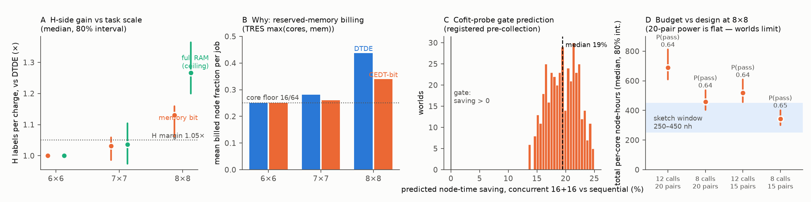

# Pre-study for live comparison No. 2 — packing, billing, and power

Run 2026-09-11 on a 2-core workstation (pure NumPy, ~15 s per config),
**before cofit probe `1940907` was collected** — the gate prediction in
§2 is registered ahead of the data so the probe grades the model, not
the other way around. All node-hours are simulated units. Script:
`prestudy.py`; data of record: `prestudy_results*.json`.

Every anchor is a measurement: 6×6 lean walls and RAM from probe
`1928420`, the s = 0.425 rank-scaling and 6–11 % contention from the
pilot and `contention_transfer_bench`, per-candidate wall multipliers and qualifier
flags from the real 1×1 campaign, RAM/wall scale exponents from the
measured 5×5→8×8 series. The only free parameters are transfer
uncertainties, swept as priors over 400 worlds.

**Calibration cross-check that fell out for free:** the 2H base wall at
6×6 implied by MoSe2 (4,451 s) and independently by WTe2 (4,327 s)
agree to 2.8 % — the per-candidate wall multipliers measured at 1×1
transfer to 6×6 almost perfectly. That is empirical support for using
the (real) 1×1 campaign as the candidate-population model.

## 1. The main design finding: 6×6 is a structural null — comparison No. 2 must run at 8×8

At 6×6 the drafted design cannot distinguish the arms *by construction*:
16-rank streams are **core-limited** (4 × 16 = 64 cores) while even
DTDE's worst-case memory reservation (≈66 GB/job) leaves the 323 GB
packing budget slack. Both arms therefore pack identically, every
charge is identical, and PW60/H-gain are exactly 1.0 in all 400 worlds
(panels A, B). The memory bit only acquires a surface where worst-case
reservations collide with the node:

| scale | DTDE billed fraction | CEDT-bit | H gain (bit) med [80 %] | P(H ≥ 1.05×) | P(PW60) | P(joint) |
| --- | ---: | ---: | --- | ---: | ---: | ---: |
| 6×6 | 0.250 (core floor) | 0.250 | 1.000 [1.00, 1.00] | 0.00 | 0.00 | 0.00 |
| 7×7 | 0.282 | 0.260 | 1.031 [0.99, 1.06] | 0.27 | 0.35 | 0.21 |
| **8×8** | **0.438** | **0.339** | **1.131 [1.06, 1.16]** | **0.95** | 0.64 | 0.64 |

The single preregistered bit captures roughly half of the full-RAM
disclosure ceiling at 8×8 (1.13 vs 1.27) — consistent with the
Theorem-3 threshold-statistic picture.

## 2. Registered cofit-gate prediction — and a counterfactual caveat

Predicted node-time saving of concurrent 16+16 (MoSe2_2H + WTe2_2H 6×6)
vs the measured 8,645 s sequential 32-rank baseline: **median 19 %,
80 % interval 16–23 %, P(saving > 0) = 1.00** (panel C). If the probe
lands outside 16–23 %, a model input (rank-scaling s or contention) is
off and gets refit before No. 2 is finalized.

The caveat this pre-study surfaced: the probe's baseline is *sequential
32-rank*, but that is **not the DTDE counterfactual** — at 6×6 memory
is slack, so the DTDE arm under per-core billing can pack 4 × 16
ranks without any disclosure. A passing gate validates co-scheduling
physics (worth having), not a CEDT-over-DTDE gain. The arm-separating
mechanism is worst-case *reservation* under memory-aware billing, and
it turns on at 8×8, not 6×6.

## 3. Billing must be TRES-style, or the comparison is null at any scale

Under plain per-core billing (charge = wall × ranks), reservations cost
nothing, DTDE packs like CEDT, and no scale separates the arms. The
pre-study therefore proposes the preregistration bill jobs the way
co-scheduled SLURM systems actually do — **billing = wall ×
max(ranks/64, reserved GB/380)** (TRES `MAX(cpu, mem)` weighting), so
reserved memory blocks other users' cores and over-reservation is a
real cost. This is a *defensible* accounting (it is SLURM's own), but it
is an amendment the parties must accept before submission.

## 4. Power: the R metric stays luck-limited; the H metric is the strong prediction

P(PW60 passes) ≈ 0.64 at 8×8 and is **flat in seeds and calls** (panel
D) — the residual variance is world-level (which candidates are cheap,
where qualifiers land in the order), the same structural noise the
metric redesign diagnosed. The H metric passes in 95 % of worlds. Two
consequences:

- **Cheapest adequate design: 8×8, 8 calls/campaign, 15 pairs — median
  343 per-core nh (80 % interval 301–402)**, inside the 250–450 sketch
  window. More seeds buy nothing.
- Governance option: since the packing mechanism is
  H-side, grading **H as primary** (P ≈ 0.95) with PW60 reported as
  secondary would make No. 2 a strong-prediction test instead of a
  coin-flip; keeping PW60 primary is defensible but expect ~1-in-3
  failure by luck even if the mechanism is real.

## 5. Leakage note for the preregistration

At these scales RAM is phase-dominated (2H ≈ 1.5× 1T), so the
population-median memory bit is nearly a **phase bit**. The
composition/phase inference limit (advantage ≤ 0.10) must be graded on
the bit channel explicitly; with public CC0 candidates this is a
stand-in measurement, but for a proprietary campaign the bit would need
to be defined *within* phase-homogeneous classes to stay legal.

## Model caveats

FIFO launch order (no broker reordering — conservative for CEDT); RAM
at 16 ranks taken equal to the 32-rank total (slightly conservative);
no job failures (0/81 pilot, 29/30 campaign); linear contention in
active streams, anchored at the measured 2-stream 6–11 %; scale
exponents extrapolated one step beyond measurement for 8×8 RAM on 1T
(2H is measured). The cofit probe and the first 8×8 jobs of No. 2
itself are the checks on these.
