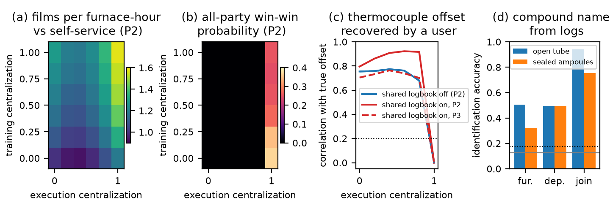

# Shared growth stations (simulated): results

Design and predictions S1 to S7: `DESIGN_AND_PREDICTION.md` (registered and
committed before the simulator). Code: `station_sim.py`,
`analyze.py`, `make_figure.py`. Run: 150 worlds x 15 paired seeds x 78
conditions, 132 s on 8 cores. Graded numbers: `results/station_summary.json`,
`results/predictions_graded.json`. The 74 MB per-campaign file is not committed;
`python station_sim.py --worlds 150 --seeds 15 --procs 8` regenerates it
exactly (all random streams are seeded per world and seed).

Every station number (temperatures, rates, run times, calibration errors) is an
assumed value, not a measurement. The only measured input is the list of eight
MX2 compositions with a PBE gap in the 1.0 to 2.0 eV window.

## The setting in one paragraph

Four groups grow few-layer MX2 films from their own lists of five window
compositions. Each attempt is a metal film sputtered on a shared deposition
line, then converted in a shared tube furnace under chalcogen vapour. The line
operator knows how far each target's rate has drifted from nominal; the furnace
operator knows how far its thermocouple reads from the sample temperature.
Groups either run their own recipes (self-service) or hand the job to the
operator's broker, which applies the private correction and batches work
(co-firing compatible boats from different groups, ordering depositions by
target). A shared logbook passes finished-attempt records between groups.

## Registered predictions

| | prediction | result | verdict |
|---|---|---|---|
| S1 | shared logbook shortens a group's hours to first film by at least 10 % | -0.4 % (20.6 h either way) | fail |
| S2 | full brokering gives at least 1.05 x films per furnace-hour in at least 80 % of worlds (P3) | 95 % of worlds, median 1.19 x | pass |
| S3 | furnace-log identification above 0.175 in at least 95 % of worlds, every arm | lowest arm 98 % | pass |
| S4 | sealed ampoules lower furnace-log identification by at least 0.15 and raise the co-firing gain | 0.51 to 0.32; gain 1.19 x to 1.26 x | pass |
| S5 | each log alone at most 0.60, the joined logs at least 0.85 | furnace 0.51, deposition 0.49, joined 0.94 | pass |
| S6 | shared logbook lets a group recover the thermocouple offset (correlation at least 0.5 at P2, 0.2 at P3) | 0.80 (P2), 0.70 (P3) | pass |
| S7 | no win-win under the absolute identity limit; at least 0.5 under the rebased limit with no logbook | 0 everywhere; best rebased 0.37 | fail |

## Findings

1. **The training axis gains slope at a growth station, on the operator's
   side.** With self-service recipes, a fully shared logbook raises films per
   furnace-hour from 1.00 to 1.28 x (P2, named compounds) or 1.18 x (P3,
   chalcogen tube and 50 C band only); on the computing node the same axis moved
   throughput by at most 2.4 %. The reason is the one stated in the design:
   another group's failed MoSe2 boat at 760 C tells everyone where the window is
   on this particular furnace, which a band-gap result never did for DFT run
   time. The gain shows in fewer failed boats over the whole list, not in the
   time to the first film (S1 fails), because most groups make their first film
   within one or two runs either way.
2. **Partial brokering is worse than either end.** Films per furnace-hour
   falls to 0.93 to 0.98 x and good films per deposition-hour to 0.84 to 0.88 x
   when 20 to 60 % of jobs go through the broker. A group whose two boats are
   split between the broker and its own recipe can no longer fire them in one
   run, and brokered depositions queued after self-service ones force extra
   target changes. In shop-floor terms, splitting one lot across two routings
   loses the batch. On the computing node the opposite held: half delegation
   captured most of the gain. At a batch station the contract has to move whole
   lots.
3. **Full brokering carries both operators' gains and hides their settings
   books.** At full brokering the furnace delivers 1.19 x films per
   furnace-hour (co-firing across groups) and the line 1.34 x good films per
   deposition-hour (target changes cut by ordering), in 95 % and 100 % of
   worlds. It is also the only setting in which users do not learn the
   operators' calibrations: a self-service user recovers the thermocouple
   offset from its own runs (correlation 0.75 with no logbook, up to 0.92 with
   one) and the target rate factors from its own thickness measurements (0.92
   to 0.99). A broker that applies the correction without showing it drops both
   to zero. On the node, the operator's tuning knowledge was never exposed to a
   self-service user; at a growth station every user who measures its own
   product does so.
4. **The log is the recipe, and padding cannot hide it.** The furnace
   operator names the compound from its own controller log (tube plus sample
   temperature) in 51 % of boats and the line operator from the target in 49 %,
   against 12.5 % by guessing and a limit of 17.5 %; joined through the billing
   account, the two logs name it in 94 %. A programme menu that only allows
   50 C or 100 C steps does not help (0.49 to 0.52) and costs films (17.5
   against 18.3 per campaign at 100 C steps), because the temperature must stay
   near the window for the film to form. Physical containment helps more than
   log editing: sealed ampoules, which stop the tube from announcing the
   chalcogen and let boats of different chalcogens share a run, lower the
   furnace log to 32 % and the join to 75 %, and raise the co-firing gain to
   1.26 x. Every value is still above the limit.
5. **Win-win.** Because the operator must read the recipe to run it, the
   absolute identity limit fails in every arm (S7, first half, as predicted).
   Graded on the identity added by the contract beyond self-service, only the
   full-brokering column is non-zero, best 0.37 without a logbook and 0.25 to
   0.33 with one (S7, second half, fails against 0.5). The binding party is the
   research group: its paired win rate on hours to first film passes in 45 % of
   worlds, while both operators gain in almost every world.

## Comparison with the computing node

| | computing node (measured, plus twin) | furnace and deposition line (simulated) |
|---|---|---|
| shared logbook (training axis) | at most 2.4 % throughput | up to 1.28 x furnace throughput |
| partial delegation | captures most of the gain | worse than none (lots are split) |
| operator's settings book seen by self-service users | no | yes, from the user's own measurements |
| log leakage closable by editing the log | timing padding works at a price | no; containment (sealed ampoules) helps partly |
| best contract | broker with minimal disclosure (CEDT-P4) | full brokering, no logbook |
| party that limits win-win | research group (paired win rate) | research group (paired win rate) |

## Limits

- All station parameters are assumed; the windows, offsets and drift scales
  set how much the logbook and the broker can gain.
- Offsets and rate factors are constant within a campaign (no thermocouple
  ageing or target erosion), so the logbook never goes out of date.
- The identification attack scores one log entry at a time; an operator who
  pools all entries from one account would do better, so the values above are
  lower bounds.
- Leakage of one group's list to the other groups through the logbook is not
  graded.

## Possible extensions

1. Replace the assumed station with logged data: any group furnace or
   deposition log, or liquid-handling station logs, to test finding
   4 on a recorded station.
2. Add thermocouple drift and target erosion, so the shared logbook can go out
   of date, and test whether that restores a role for partial delegation.
