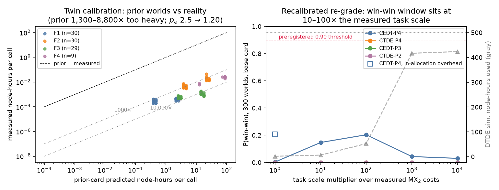

# Stage 2 — empirical twin fit and recalibrated re-grade

Stage 2 (2026-09-08): fit the empirical symbolic digital twin to the measured outcome vectors of
the actual-DFT campaign (`../dft_campaign/`), then confront the
prior-predictive worlds with reality.

Dataset: `qe_calls.csv` — 98 measured QE calls (30 candidates × F1–F4
ladder, deduplicated final record per stage; SOC calls append once
`../dft_campaign/soc/results/` is collected). All prior-world node-hours
remain simulated units; measured node-hours are real granite `grn061`
measurements.

## 1. Parametric calibration of the twin's own cost family (`fit_twin.py`)

The prior twin assumed `nh = A[fid]·(nelec/38)^p_e·(nk/36)^p_k·(ecut/40)`
with `p_e ~ N(2.5, 0.2)` and `A = [0.03, 1.2, 12, 8, 40]`. Fitting the
same family to the measured calls (log-linear, shared exponent,
per-stage amplitude; R² = 0.95, n = 98):

| parameter | prior card | measured | note |
| --- | --- | --- | --- |
| p_e (electron exponent) | 2.5 ± 0.2 | **1.20** | tiny cells: cubic-scaling regime not reached |
| A(F1) | 1.2 | 0.000398 | prior/measured **3,015×** |
| A(F2) | 12.0 | 0.009462 | **1,268×** |
| A(F3) | 8.0 | 0.000906 | **8,830×** |
| A(F4) | 40.0 | 0.015754 | **2,539×** |
| residual sd (log) | 0.25 assumed | 0.34 | slightly noisier than assumed |
| mem model | 30·(nelec/38)²+8 GB | ≈ 0.14 GB/rank, flat (R² ≈ 0) | **memory channel dead at this scale** |

The prior cards described a task two to four orders of magnitude
heavier than the real 3–6-atom MX₂ ladder. The memory finding matters
for the contract design: the "memory bit" that earlier rounds identified
as the threshold-sufficient statistic carries **no information for this
workload** — every job fits in a fraction of a GB per rank.

**Identifiability (honest limits of this dataset):** every stage ran one
fixed k-grid and one execution config (16 ranks / 4 pools, dedicated
node), so `p_k`, parallel efficiency `s`, pool-mismatch, quirks, and
contention are *not identifiable* — their priors are carried unchanged.
The randomized 81-job pilot (`../pilot/`) remains the designed
instrument for exactly those parameters. This is the concrete Stage-2
form of the spec's "randomized microbenchmarks first" rule.

## 2. Free-form symbolic refit (`pysr_fit.py`, PySR on the DGX)

Stage-1 protocol: split by candidate (never by round), validation-based
complexity selection. Selected expression for `log(nh)` per call
(complexity 22, validation MSE 0.067, R² = 0.971 overall):

```
((-4.595 - nk/(1.0664^nk - 0.131)) - log(1.0102^nk · 0.610^nat)) · log(log(nelec))
```

An in-range interpolator, not physics — per the Stage-1 lesson it must
not be extrapolated. Its structure independently confirms the
parametric finding: electron-count dependence enters only as
`log(log(nelec))` (extremely weak at 24–52 electrons), while the k-grid
and atom count carry most of the variance.

## 3. Recalibrated re-grade + task-scale sweep (`recalibrate.py`, DGX)

The twin was patched with the measured cost/memory model (unidentifiable
parameters kept at priors) and the main condition grid re-graded on 300
worlds (base card, hard budget cap on). Because the real task is ~10³×
lighter than the prior worlds, a task-scale multiplier ×1…×10⁴ locates
where the frozen 500-simulated-nh budget matters:

| scale × measured | overhead | best contract | P(win-win) | DTDE nh used / 500 |
| ---: | --- | --- | ---: | ---: |
| 1 | per-sbatch (0.02 nh) | CEDT-P4 | 0.003 | 2.0 |
| 1 | in-allocation (0.0005 nh) | CEDT-P4 | 0.207 | 0.55 |
| 10 | per-sbatch | CEDT-P4 | 0.147 | 6.6 |
| 100 | per-sbatch | CEDT-P4 | **0.203** | 52.9 |
| 1,000 | per-sbatch | CEDT-P4 | 0.043 | 416.7 |
| 10,000 | per-sbatch | CEDT-P4 | 0.030 | 423.4 |



Findings, in decision order:

1. **At the real MX₂ task scale the privacy-tax question is degenerate.**
   With per-sbatch overhead every job costs the same ~0.02 nh regardless
   of candidate or information contract, so no contract can buy a 10%
   node-hour reduction (P(R gain) = 0.003). The campaign completes the
   whole ladder for ~2 of the 500 budgeted node-hours in every arm.
2. **The win-win window is 10–100× heavier tasks** (larger supercells,
   denser k-grids, more candidates): costs differentiate but the budget
   stays loose — CEDT-P4 peaks at P(win-win) ≈ 0.20. Above ~1,000× the
   budget binds and feasibility collapses again (at 10⁴× only 0.22
   qualifiers are found on average).
3. **Scheduling overhead is a first-order term of the contract**, same
   order as the F2 relaxation itself (0.02 vs 0.009 nh). In-allocation
   batching at measured scale is worth more than any disclosure level
   (P(win-win) 0.207 vs 0.003). Contract clauses about job batching are
   worth more than clauses about descriptor granularity for light tasks.
4. **The 0.90 preregistered threshold stays unreachable everywhere**
   (max 0.21) — the MRD infeasibility finding survives empirical
   calibration; the binding constraint is still R's reservation margin,
   now with measured (not assumed) cost physics behind that conclusion.
5. **P4's leakage dominance is unchanged** (leak-ok = 1.000 throughout);
   the calibration moved utility, not leakage.

## Files

- `build_dataset.py` → `qe_calls.csv` (98 rows; re-run after SOC collect)
- `fit_twin.py` → `twin_fit.json` (parametric calibration)
- `pysr_fit.py` → `pysr_wall_fit.json` (DGX, `~/mpt_stage1/venv`)
- `recalibrate.py` → `recalibrated_grade.json` (DGX, 300 worlds)
- `stage2_calibration.png` — the two-panel summary figure

## Caveats

Single prior card (base) for the re-grade; 300 worlds (±0.02–0.03 on
the probabilities); overhead scenarios are estimates (queue waits on a
busy partition would be larger and more variable, which would further
flatten contract differences at light scales); the scale multiplier
scales memory as `scale^0.5` as a conservative coupling; SOC rows not
yet in the fit (job 1914220 running at commit time).
