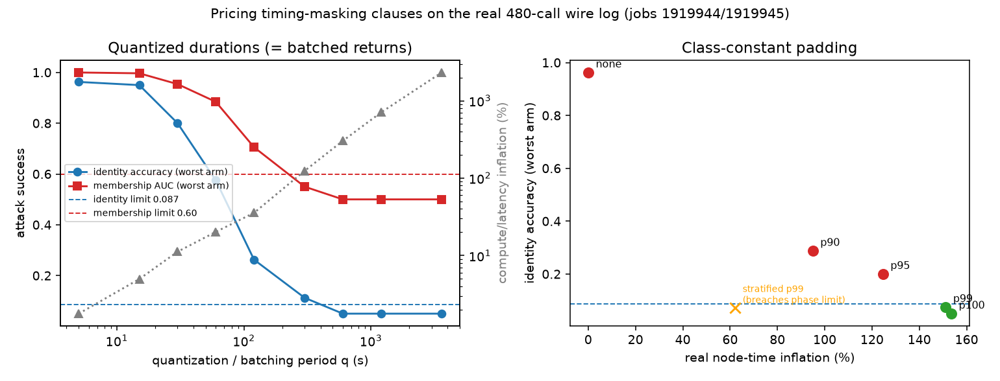

# Timing masking, priced on the real wire log (future-work item 2)

**Question.** The live comparison's executed attacks showed that wall-time
fingerprints alone identify candidates at 96.3% (limit 8.7%) and give
membership AUC 1.000 (limit 0.60) at every disclosure level including P4.
What do the proposed masking clauses cost, and do they actually close the
channel?

**Method.** The two masking clauses below are applied to the
480 measured QE calls of jobs 1919944/1919945 and re-attacked with the
identical leave-one-seed-out attacks of `paired_comparison_1/wire_attack.py`:

- **Quantized durations / batched returns** — completion messages are held
  to the next q-second boundary (a batching period T is the same transform
  with q = T). Cost: held time in a serial campaign (latency; also billed
  compute under whole-node accounting).
- **Class-constant padding** — every job of a calculation class is padded
  to that class's p-th percentile wall. Cost: real held node time.

All numbers are measured walls re-attacked; nothing is simulated.
Data: `mask_results.json`; script: `mask_study.py`.

## Results

| clause | leakage outcome | cost |
| --- | --- | --- |
| none (as run) | identity 0.963, mem-AUC 1.000 — both breached | 0 |
| quant 60 s | identity 0.575, AUC 0.884 — both breached | +20% |
| quant 300 s | AUC passes (0.55); identity still 0.113 > 0.087 | +124% |
| **quant 600 s** | **both pass** (identity 0.050, AUC 0.500) | **+304%** |
| pad to class p95 | AUC passes (0.48); identity 0.200 > 0.087 | +125% |
| **pad to class p99** | **both pass** (identity 0.075, AUC 0.501) | **+151%** |
| pad stratified by (class, phase), p99 | identity within-stratum chance, but **breaches the composition/phase limit structurally** (duration stratum reveals 1T vs 2H exactly; advantage ≈ 0.48 vs limit 0.10) | +62% |

## Findings

1. **Closing the timing channel at this job scale costs 1.5–3× the entire
   compute budget.** The cheapest fully-passing clause (pad to class p99)
   inflates real node time by +151%; quantization needs 10-minute bins
   (+304%) because the jobs themselves are only 0.5–6 minutes long. The
   masking cost is set by the *relative spread* of wall times within a
   class — here huge, since 1T (27-atom) and 2H (54-atom) candidates share
   a class and differ ~2–6× in wall.
2. **The cheap variant trades one leak for another.** Stratifying the
   padding classes by phase drops the cost to +62%, but the stratum is
   readable off the padded duration, so phase inference becomes exact —
   structurally breaching the 0.10 composition/phase advantage limit. On
   this candidate set there is no padding partition that is both
   size-homogeneous (cheap) and composition-blind (legal).
3. **Scale is the real remedy.** All masking costs quoted here are
   *fractions of job wall time*. At ×10–×100 task scale (jobs of 1–10 h),
   a 600-s quantization — the same absolute anonymity — costs +0.2–2%
   instead of +304%. Timing privacy is nearly free for big jobs and
   ruinous for small ones; one more reason the whole contract question
   only makes sense in the heavy-job regime (see `billing_regrade/` and
   `coupling_onset/`).
4. **Scope caveat (unchanged from the attack study):** masking protects
   the wire — broker transcripts, audit logs, third parties, and retained
   histories. The executing party H physically times its own runs; against
   H itself the protection is not masking but reference deprivation
   (proprietary candidates H cannot label) plus noisy shared hardware.
   The attacks here use masked references (a wire-only attacker); an
   executor with clean self-measured references would do somewhat better
   at small q, so treat the small-q rows as lower bounds.
